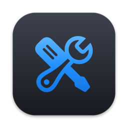
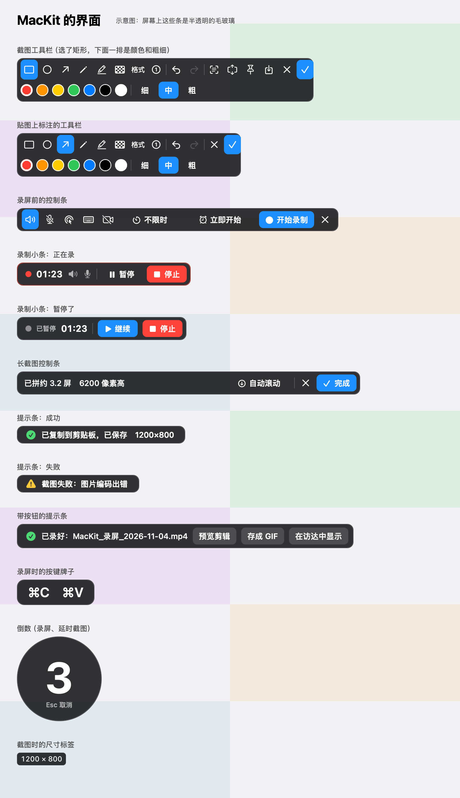
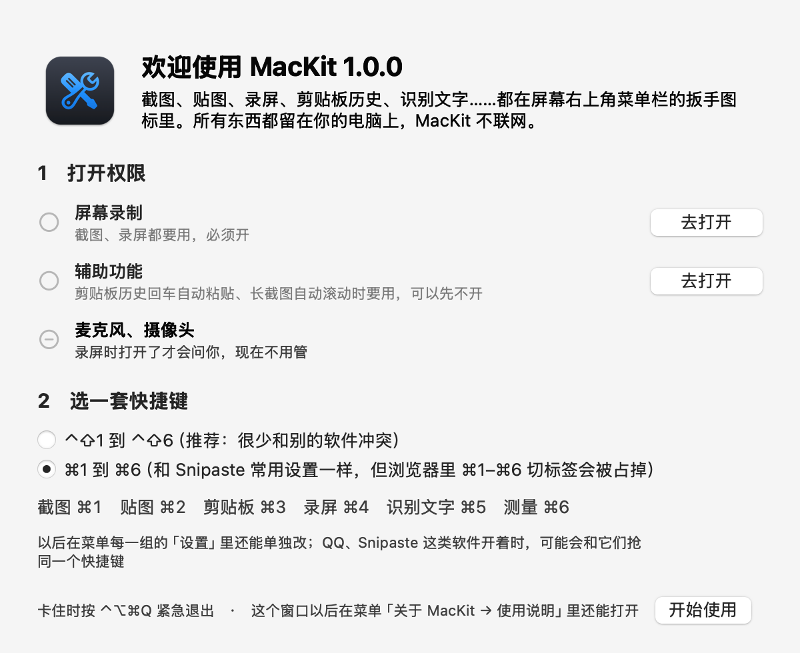

<p align="center"></p>

<h1 align="center">MacKit</h1>

<p align="center">住在 Mac 菜单栏里的小工具箱：截图、贴图、标注、长截图、录屏、剪贴板历史、识别文字……<br>免费、开源、不联网。</p>

## 能干什么

- **截图**：框选区域、单击选窗口、整屏、延时截图；截完直接标注（矩形、椭圆、箭头、画笔、荧光笔、马赛克、文字、序号），复制并存成 PNG
- **长截图**：框住网页或聊天记录往下滚，自动拼成一张长图，固定的导航栏、输入框只留一份；也能让它自动滚
- **贴图**：把截图、剪贴板里的图片或文字钉在屏幕最上层，滚轮缩放、调透明、鼠标穿透，贴图上也能标注
- **录屏**：区域、窗口、整屏，系统声音和麦克风；暂停继续、定时、预览剪辑、存成 GIF；显示鼠标点击和按键、摄像头画中画
- **剪贴板历史**：文字、图片、文件都记下来，打字就能搜（截图里的字也能搜），回车粘贴、置顶；密码不记
- **识别**：框选识别文字（中英日韩）和二维码；截图时取色；测量宽高
- **小工具**：防休眠、看 CPU / 内存 / 网速 / 磁盘 / 电池、系统排窗口快捷键的小抄

<p align="center"></p>

## 系统要求

- macOS 15（Sequoia）或更新
- Apple 芯片和 Intel 的 Mac 都能装（Intel 的还没人测过，有问题欢迎提 Issue）

## 安装

1. 到 [Releases](https://github.com/itzzan/MacKit/releases) 下载最新的 `MacKit-版本号.dmg`
2. 双击打开，把 MacKit 拖进"应用程序"
3. 打开 MacKit。第一次系统会说"无法验证开发者"——因为 MacKit 没有付费给苹果做公证，不是有问题：
   - 先点"完成"关掉提示
   - 打开"系统设置 → 隐私与安全性"，往下翻，看到"已阻止打开 MacKit"，点"仍要打开"，输入开机密码
4. 屏幕右上角菜单栏出现一个扳手图标，同时弹出欢迎窗口：按里面的提示开权限、选一套快捷键

想确认下载的安装包没被改过：Releases 页面写着它的 SHA-256，在终端里运行 `shasum -a 256 ~/Downloads/MacKit-*.dmg` 对一下。

<p align="center"></p>

## 要开的权限

| 权限 | 干什么用 | 必须吗 |
|---|---|---|
| 屏幕录制（系统设置里叫"录屏与系统录音"） | 截图、长截图、录屏、识别文字 | 必须 |
| 辅助功能 | 剪贴板历史回车自动粘贴、长截图自动滚动 | 可以不开 |
| 麦克风 | 录屏时录你说话 | 录屏时打开了才会问 |
| 摄像头 | 录屏时的摄像头画中画 | 录屏时打开了才会问 |

## 快捷键

第一次打开时选一套；以后在菜单每一组的"设置"里还能单独改。

| 功能 | 推荐的一套 | 另一套 |
|---|---|---|
| 截图 | ⌃⇧1 | ⌘1 |
| 贴图 / 全部隐藏或显示 | ⌃⇧2 / ⌃⌥⇧2 | ⌘2 / ⇧⌘2 |
| 剪贴板历史 | ⌃⇧3 | ⌘3 |
| 录屏（录制中再按一次 = 停止） | ⌃⇧4 | ⌘4 |
| 识别文字 | ⌃⇧5 | ⌘5 |
| 测量 | ⌃⇧6 | ⌘6 |
| 紧急退出（卡住时） | ⌃⌥⌘Q | ⌃⌥⌘Q |

另一套和 Snipaste 的常用设置一样，但会占掉浏览器里 ⌘1–⌘6 切标签。

截图框选后：回车完成、Esc 取消、⌘S 另存、⌘2 钉成贴图、C 复制鼠标处的颜色、方向键微调；标注工具按首字母切换（R 矩形、A 箭头、T 文字、M 马赛克……）。

## 常见问题

**截图没反应、截出来是黑的、只截到桌面**
屏幕录制权限没开好：打开"系统设置 → 隐私与安全性 → 录屏与系统录音"，打开 MacKit。已经开着还不行：选中 MacKit，点下面的"−"删掉，再按一次截图快捷键重新授权。

**更新到新版本后截图不行了**
同上：删掉重新授权。MacKit 没做苹果公证，每个新版本系统都当成一个新软件。

**按一下快捷键弹出两个截图**
Snipaste、QQ 之类的软件也用了同一个快捷键。退出它们，或者在 MacKit 菜单"截图设置"里换一个。

**菜单栏里找不到扳手图标**
菜单栏图标太多时，会被屏幕顶部的刘海挡住。按住 ⌘ 拖动菜单栏图标可以重新排；也可以用 Ice 这类软件把不常用的图标藏起来。

**MacKit 卡住了**
按 ⌃⌥⌘Q 紧急退出。

**截图、录屏存在哪**
截图在"图片/MacKit"，录屏在"影片/MacKit"，剪贴板历史在 `~/Library/Application Support/MacKit/Clipboard`。保存位置在菜单各组的"设置"里能改。

## 隐私

MacKit 不联网：没有统计、没有崩溃上报，也不自己检查更新（菜单里的"看看有没有新版本"只是用浏览器打开 Releases 页面）。截图、录屏、剪贴板历史都只存在你自己的电脑上。

## 开发

用 Swift 和 AppKit 写，每个工具是一块独立的"积木"（`MacKit/Tools/` 下一个文件夹）。开发过程（每一步的任务单、怎么定下来的）在 [docs/开发记录](docs/开发记录/方案.md)，更新记录见 [CHANGELOG.md](CHANGELOG.md)。

### 编译、测试

装了 Xcode 就用 Xcode 编译，没装就用命令行工具。两种方式的产物都是 build/MacKit.app。

```bash
scripts/test.sh                 # 全部检查：坐标单元测试 + 编译 + 应用自检
scripts/build.sh                # 只编译
scripts/install.sh              # 编译、装到 ~/Applications 并启动
scripts/install.sh --no-open    # 只装不启动
scripts/smoke-record.sh         # 录屏实录检查：真的录几小段、拼接、转 GIF 再删掉（会短暂出现系统的录屏标志）
scripts/smoke-longshot.sh       # 长截图实录检查：真的拍屏幕左上角一小块 1.5 秒，看尺寸、量拼接速度（会短暂出现系统的录屏标志）
build/MacKit.app/Contents/MacOS/MacKit --style-preview 输出.png 标题 [左边一栏.png]   # 样张：把各个浮动条、按钮画进一张图（不弹窗口）
build/MacKit.app/Contents/MacOS/MacKit --welcome-preview 输出.png [dark]   # 把欢迎窗口画成图（不弹窗口、不改设置）
scripts/make-icon.sh            # 重画 App 图标（用代码画，打包成 MacKit/Resources/AppIcon.icns）
scripts/release.sh              # 做发布用的安装包 build/release/MacKit-版本.dmg（临时签名，签名里不带个人信息）
MACKIT_BUILDER=swiftc scripts/build.sh   # 装了 Xcode 也强制用命令行编译
```

Xcode 工程由 project.yml 生成。要改工程设置，改 project.yml，然后运行：

```bash
xcodegen generate
```

签名：默认是临时签名，每次重编都要重新给录屏权限。
把 Config/Local.xcconfig.example 复制成 Config/Local.xcconfig 并填上团队编号，
就会改用 Apple Development 证书。这个文件不进 git。

### 目录

```
MacKit/
  App/            程序入口、自检、样张、画 App 图标
  Core/           公共积木：快捷键、设置、权限、提示条、菜单、截图记录、统一样子（Theme）
  Tools/
    Screenshot/   截图：冻屏、选区覆盖层、坐标换算、复制和保存
    Pin/          贴图：贴图窗口、缩放透明度、读剪贴板、文字卡片、贴图上标注
    Annotate/     标注：八种工具、工具栏、撤销重做、马赛克、导出
    Clipboard/    剪贴板历史：盯剪贴板、跳过密码、存盘、小窗口、自动粘贴
    Recorder/     录屏：选区域、控制条、倒计时、红框、录制小条、暂停拼接、定时、预览剪辑、GIF、点击高亮、按键显示、摄像头
    Recognize/    识别工具：识别文字和二维码、结果窗口、取色用的像素读取、测量
    LongShot/     长截图：边拍边拼的算法、控制条和预览条、自动滚动
    Misc/         杂项：系统状态（CPU、内存、网速、磁盘、电池）、防休眠、排窗口小抄
  Resources/      Info.plist、App 图标
Config/           签名设置（Local.xcconfig 是本机私有的）
Tests/            坐标换算、贴图缩放、选区调整、剪贴板文字、录屏尺寸、按键显示、识别和测量、长截图拼接、系统状态文字的单元测试
scripts/          编译、测试、安装脚本
project.yml       Xcode 工程的生成规则
```

加新工具：在 `MacKit/Tools/` 下新建文件夹，写一个遵守 `ToolModule` 的类，
再加进 `AppDelegate` 的 `modules` 列表。

### 查日志

zsh 里 `log` 是另一个同名命令，要写完整路径：

```bash
/usr/bin/log show --last 10m --predicate 'subsystem == "local.mackit"'
```

### 截图权限一直不生效

系统可能留着旧签名的权限记录。只清 MacKit 自己的记录，然后重新授权：

```bash
tccutil reset ScreenCapture local.mackit.MacKit
```

### 设置存在哪

```bash
defaults read local.mackit.MacKit
```

### 剪贴板历史存在哪

```bash
open ~/Library/Application\ Support/MacKit/Clipboard
```

index.json 是列表，blobs/ 里是图片等大内容。只存在这台电脑上。


## 协议

[MIT](LICENSE)：随便用、改、发，保留署名就行。

## 致谢

功能和操作参考了 Snipaste、CleanShot X、Shottr、iShot、PixPin、Maccy、QQ 录屏等优秀的软件。MacKit 和它们没有任何关系。
